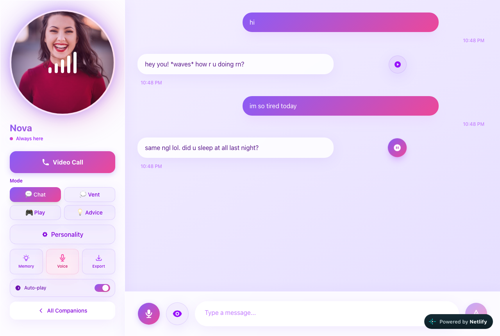

# Mini Companion

**An AI companion that texts like a real friend. It remembers you, you can tune its personality, and you can call it by voice in the browser.**

[](https://kush-mini-companion.netlify.app)
[](https://codespaces.new/KushagraKanaujia/mini-companion?quickstart=1)
[](LICENSE)



## Try it in one click

| Option | What you get | Setup |
| --- | --- | --- |
| **[Live demo](https://kush-mini-companion.netlify.app)** | The full UI in your browser: templates, the 6-step companion builder, chat, modes, personality sliders, memory viewer, export, voice calls | None |
| **[Open in Codespaces](https://codespaces.new/KushagraKanaujia/mini-companion?quickstart=1)** | The source code in a cloud VS Code. Dependencies install and the dev server opens in a preview tab | A GitHub account (Codespaces has a free monthly quota) |

> **About the demo:** the public demo runs in **demo mode**. It needs no database and no API keys. Your companions and chats are saved only in your own browser (localStorage), and replies come from a **small scripted responder, not an AI model**. The scripted replies follow the same texting rules as the real system prompt. To chat with a real model, see [Run it for real](#run-it-for-real). It is free with Ollama.

Things to try in the demo:
1. Click **Start Chatting** on a template, or **Create Your Custom Companion** and go through the 6 steps.
2. Text it something like `i failed my exam today` or `tell me a joke`.
3. Switch the mode (Chat / Vent / Play / Advice) or move the **Personality** sliders. The replies change with them.
4. Open **Memory** and **Export** (downloads your chat as JSON). Then try **Video Call** in Chrome, Edge or Safari, which uses your browser's speech recognition and text-to-speech.
5. Use **Reset demo** in the top banner to clear everything.

## What it does

- **Texts like a person.** Short lowercase messages, slang, and `*actions*`. The system prompt in [`src/lib/companion.ts`](src/lib/companion.ts) makes it reply to what you just said.
- **Long-term memory.** Every ~20 messages the conversation is compressed into a memory summary that goes into future prompts. The **Memory** panel shows exactly what it remembers.
- **Tunable personality.** Sliders for flirty, funny, supportive and deep, plus four conversation modes. These are sent along with each message as hidden "vibe settings".
- **Custom companions.** A 6-step builder covering name, personality type, speaking style, interests, avatar and backstory. It then writes a personality description with the AI model.
- **Voice calls.** Real-time speech-to-text and text-to-speech through the browser's Web Speech API, with a camera preview bubble. No paid voice API is used.
- **Your data, portable.** Export a companion, its memory and the full message history as JSON. Deleted messages are left out of context and memory.
- **Personality versioning.** Personality changes are snapshotted (`persona_versions`) so a user can pin an older version.

## How it works

```
Browser (Next.js pages)
   │  fetch /api/chat  ──►  API route builds the system prompt
   │                         (persona + memory summary + vibe settings)
   │                         ├─► Ollama (local, llama3.2:1b)   or
   │                         └─► Google Gemini Flash
   │  ◄── streamed reply      saves both messages to Supabase (Postgres)
   │
Demo mode: src/lib/demo.ts answers the same /api/* calls inside the browser
           (localStorage + scripted replies), so no server-side services are needed.
```

Demo mode turns on automatically when `NEXT_PUBLIC_SUPABASE_URL` is not set, or when `NEXT_PUBLIC_DEMO_MODE=true`.

## Tech stack

- **Next.js 16** (App Router, API routes), **React 19**, **TypeScript**
- **Tailwind CSS v4** with a custom purple/pink glassmorphism theme
- **Supabase** (Postgres) for companions, messages, memory and versions ([`supabase-schema.sql`](supabase-schema.sql))
- **Ollama** (`llama3.2:1b`, local and free) or **Google Gemini Flash** for replies and memory
- **Web Speech API** for voice calls
- Hosted demo on **Netlify** (Next.js runtime via Netlify's OpenNext adapter)

## Run locally

### Quick start (demo mode, no keys)

```bash
git clone https://github.com/KushagraKanaujia/mini-companion
cd mini-companion
npm install
npm run dev        # http://localhost:3000
```

### Run it for real

1. **Supabase** (the free tier works). Create a project, open the SQL editor, and run [`supabase-schema.sql`](supabase-schema.sql). Then copy the URL, anon key and service-role key from *Project Settings → API*.
2. **A model.** Ollama is free and runs locally:
   ```bash
   brew install ollama          # or see ollama.com for Linux/Windows
   ollama serve &               # or: brew services start ollama
   ollama pull llama3.2:1b
   ```
   Or use a Google Gemini API key. Gemini has a free tier.
3. **Environment.** Copy `.env.example` to `.env.local` and fill it in:
   ```env
   NEXT_PUBLIC_SUPABASE_URL=...
   NEXT_PUBLIC_SUPABASE_ANON_KEY=...
   SUPABASE_SERVICE_ROLE_KEY=...
   USE_OLLAMA=true
   # GOOGLE_GEMINI_API_KEY=...   (when USE_OLLAMA=false)
   ```
   Note: memory summaries currently use Gemini, so they need `GOOGLE_GEMINI_API_KEY` even when chat uses Ollama.
4. Run `npm run dev`.

Avatar uploads in the builder use a Supabase Storage bucket named `Personas`. In demo mode, uploaded photos stay in your browser.

## Project structure

```
src/
├── app/
│   ├── page.tsx                 # Home: templates + your companions
│   ├── create/page.tsx          # 6-step companion builder
│   ├── chat/[personaId]/        # Chat UI, modes, sliders, memory, voice call
│   └── api/                     # chat (streaming), personas, memory, export, ...
├── components/DemoBanner.tsx    # Demo-mode banner + installs the demo fetch handler
└── lib/
    ├── companion.ts             # System prompt, memory, versioning, export
    ├── ollama.ts                # Local model client
    ├── demo.ts                  # Demo mode (browser storage + scripted replies)
    └── supabase.ts              # Server Supabase client (lazy)
```

## Deploy your own

- **Netlify (free):** `netlify.toml` is included. `netlify deploy --build --prod` builds the demo locally and uploads it. Set the Supabase/AI env vars and remove `NEXT_PUBLIC_DEMO_MODE` to run against real services. Ollama can't run on Netlify, so use Gemini there.

## Credits

- [Next.js](https://github.com/vercel/next.js) (MIT), [Tailwind CSS](https://github.com/tailwindlabs/tailwindcss) (MIT), [Supabase JS](https://github.com/supabase/supabase-js) (MIT), [Ollama](https://github.com/ollama/ollama) (MIT)
- [Netlify Next.js runtime / OpenNext adapter](https://github.com/opennextjs/opennextjs-netlify) (MIT), used for the hosted demo
- [Dev Containers images](https://github.com/devcontainers/images) (MIT): the `typescript-node` image behind the Codespaces setup
- Badges by [shields.io](https://shields.io) (CC0)
- Template portraits from [Unsplash](https://unsplash.com/license); gallery placeholders from [pravatar.cc](https://pravatar.cc)

## License

[MIT](LICENSE)
